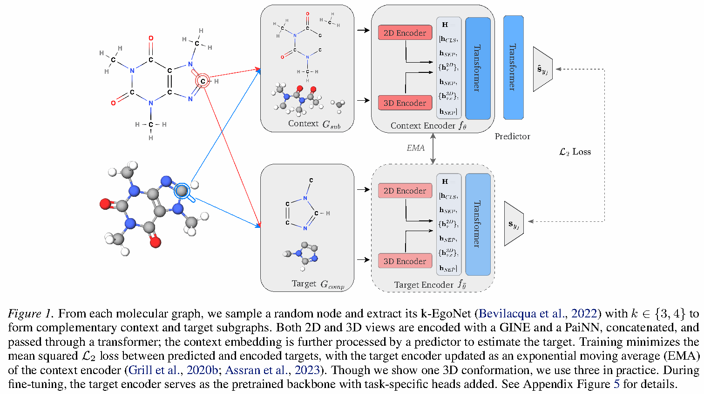
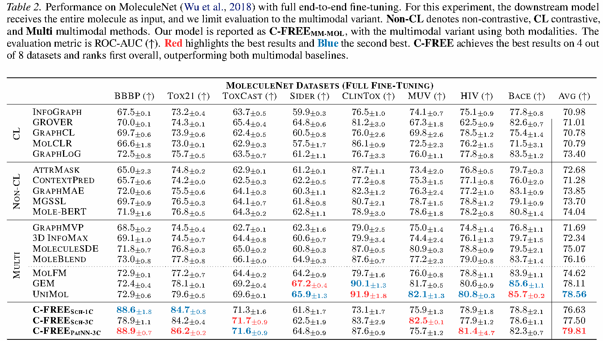

## 一句话总结

C-FREE 把分子切成互补的邻域子图，同时编码二维结构与多个三维构象，在潜在空间中预测缺失子图的表示；通过不使用负样本的预训练，为分子性质预测提供可迁移的模型起点。

## 研究背景与动机

分子性质标注通常需要实验或量化计算，成本高、数据量有限。分子图预训练希望先从无标签分子中学习结构知识，再适配下游任务，但存在两类设计负担：对比学习要选择增强和负样本，生成式方法则需要重建原子、键或几何信息。

二维图描述原子与键的连接关系，三维构象描述同一分子的空间排列。只用二维图会遗漏几何信息，只选一个构象也无法完整表达构象变化。C-FREE 的目标是利用这两种信息，在表示空间定义一个较简单的预测任务。依据：论文第 1–3 节。

## 方法详解

1. **构造互补视图。** 在分子中选择一个锚点原子，取其固定跳数邻域作为上下文，剩余部分作为目标。Figure 1 使用半径为 3 或 4 的自我邻域子图（EgoNet）；两部分在图结构上互补，并配上相应的三维坐标。
2. **分别编码二维和三维信息。** 二维结构由 GINE 编码，三维构象由 PaiNN 或 SchNet 编码。各模态表示拼接后交给 Transformer。图中为清楚起见只画一个构象，实际多构象设置使用三个。
3. **预测目标表示。** 上下文编码器之后接预测器，估计目标子图的潜在表示。损失比较预测表示与目标编码器产生的表示，而不是重建原始原子属性或坐标，也不构造负样本。
4. **更新目标网络。** 目标编码器通过上下文编码器参数的指数滑动平均（EMA）更新，提供较稳定的预测目标。
5. **适配下游任务。** 预训练后的目标编码器作为模型主干，可以冻结后做线性探测，也可以带任务头整体微调。对子图表示还可以使用 DeepSets 聚合。

*图 1：原论文 Figure 1，截取自正式 PDF 第 3 页，保留原图及英文图注。作者：Boshra Ariguib、Mathias Niepert、Andrei Manolache；来源：ICML 2026，PMLR 306:3452–3472，CC BY 4.0。*

[原图及论文来源](https://raw.githubusercontent.com/mlresearch/v306/main/assets/ariguib26a/ariguib26a.pdf) · [许可](https://creativecommons.org/licenses/by/4.0/)

## 实验关键数据

论文在 GEOM 的约 33 万个分子上预训练。MoleculeNet 分类实验报告三个 scaffold 数据划分的平均 ROC-AUC，数值越高越好。冻结主干与全量微调是两种不同协议，不能把对应结果混成一个总排名。

| 评估协议 | 方法 / 设置 | 平均 ROC-AUC |
| --- | --- | --- |
| 冻结主干，Table 1 | GraphCL | 65.04 |
| 冻结主干，Table 1 | C-FREE 仅二维，整分子表示 | 66.63 |
| 冻结主干，Table 1 | C-FREE 仅二维，子图聚合 | 67.27 |
| 冻结主干，Table 1 | C-FREE 多模态，整分子表示 | 71.07 |
| 全量微调，Table 2 | UniMol | 78.56 |
| 全量微调，Table 2 | C-FREE SchNet，三个构象 | 77.50 |
| 全量微调，Table 2 | C-FREE PaiNN，三个构象 | 79.81 |

Table 2 中，C-FREE PaiNN 版本平均值比 UniMol 高 **1.25 个百分点**，但不是每个数据集都领先。例如 SIDER 为 64.8，对照 UniMol 为 65.9；BACE 为 82.3，对照为 85.7。骨干网络和预训练数据规模也不同，因此这不是单独改变预训练目标的受控消融结论。

*图 2：原论文 Table 2，截取自正式 PDF 第 6 页，保留完整表格及图注。ROC-AUC 越高越好；不同列对应不同数据集。作者及许可同图 1。*

[表格来源](https://raw.githubusercontent.com/mlresearch/v306/main/assets/ariguib26a/ariguib26a.pdf)

Table 3 的 QM9 回归使用 MAE，越低越好，不能与 ROC-AUC 混用。Table 4 的 Drugs-75K 标签效率实验中，1% 标签下 IP 的 MAE 从随机初始化的 0.638 降至预训练微调的 0.608；100% 标签下，两者 IP 都为 0.419。这说明收益随任务与标签规模变化，并非使用预训练后所有指标都会提升。

## 亮点与洞察

这篇论文的主要价值是预训练任务的组织方式：先利用局部邻域构造互补视图，再在潜在空间预测目标，而不是依靠复杂的化学增强或原始输入重建。二维连接与三维构象在同一任务中参与学习，使训练信号不局限于某一种表示。

冻结评估检查表示能否直接被线性头利用，全量微调检查模型能否适配具体任务，标签效率实验检查少量标注时的收益。三个证据维度共同帮助理解迁移能力，不能仅凭一个平均分判断模型的适用范围。

对 AI4S 的启发（解读推断）：设计预训练任务时，可以先明确数据中有哪些互补信息，再寻找需要利用这些信息才能完成的预测目标。这是研究思路，不代表论文已验证材料、蛋白质或其他领域。

## 局限与展望

三维分支需要可用的构象。论文第 4.2.1 节说明，SIDER 中部分较大分子生成构象失败，采用占位坐标处理，作者认为这可能解释该数据集上的不足。实际使用时应记录构象失败率及处理方法，而不是只记录平均性能。

比较方法的架构、预训练数据量和模态不同，平均结果有助于评估整体方案，但无法把全部收益归因于某一个模块。标签效率实验的数据与预训练分子存在重叠，预训练不使用下游标签；这与测试“完全未见过的分子分布”是不同的问题。

本文没有在真实药物研发闭环、实验合成或临床结果上验证模型。这里展示的是分子表示与性质预测证据，不把它改写成实际药物发现效果。

## 相关工作与启发

GraphCL 通过增强视图进行对比学习，AttrMask 等方法重建被遮蔽属性，JEPA 类方法在潜在空间预测目标。C-FREE 属于最后一类，同时利用分子二维结构与三维构象。

需要区分“图神经网络”和“预训练”两个标签：前者描述处理图结构的模型方法，后者描述下游适配前的训练阶段，不能互作别名。这也是本次入库新增图神经网络标签、复用预训练标签的理由。

## 复现与阅读建议

先看 Figure 1 的上下文、目标与 EMA 更新关系，再核对第 3 节训练目标。阅读 Tables 1–4 时分别记录冻结 / 微调协议、二维 / 三维模态、构象数量、数据划分和指标方向。

官方代码仓库为 [ariguiba/C-FREE](https://github.com/ariguiba/C-FREE)。仓库提供预训练与微调配置，以及 GEOM、MARCEL 数据准备说明。复现时固定代码版本、数据版本、构象生成流程、划分和随机种子；不能用重新生成的随机划分替代论文协议。

本次核对了公开论文、作者单位、原摘要、原图和引用表格，未下载训练数据、运行训练或独立复现论文指标。入库流程测试与模型实验复现是两件不同的工作。

<!-- language: en -->

## One-sentence summary

C-FREE learns transferable molecular representations by predicting complementary subgraph embeddings from 2D topology and ensembles of 3D conformers, without using negative samples.

## Background and motivation

Molecular labels can require costly experiments or quantum calculations. Contrastive approaches depend on augmentations and negatives; generative methods reconstruct raw attributes or geometry. C-FREE instead predicts latent representations while combining complementary topological and geometric information. Sources: Sections 1–3.

## Method explained

The model samples fixed-radius ego-nets as context and uses the remaining graph as target. GINE encodes topology, while PaiNN or SchNet encodes geometry. Their representations are combined by a Transformer. A predictor estimates the target representation; the target network follows the context network through an exponential moving average. Pretraining minimizes representation prediction error without negatives or raw-input reconstruction. The pretrained target encoder supports frozen probing or full fine-tuning. Figure 1 illustrates one conformer; the multi-conformer setting uses three.

*Original Figure 1, extracted from page 3 of the formal paper with its caption. Boshra Ariguib, Mathias Niepert and Andrei Manolache, ICML 2026, PMLR 306:3452–3472. CC BY 4.0.*

[Figure source](https://raw.githubusercontent.com/mlresearch/v306/main/assets/ariguib26a/ariguib26a.pdf) · [License](https://creativecommons.org/licenses/by/4.0/)

## Key experimental evidence

Pretraining uses approximately 330K GEOM molecules. MoleculeNet classification reports mean ROC-AUC over three scaffold splits; higher is better. Frozen probing and full fine-tuning are separate protocols.

Table 1 averages are 65.04 for GraphCL, 66.63 for C-FREE 2D whole-molecule probing, 67.27 for 2D subgraph aggregation, and 71.07 for multimodal whole-molecule probing. Table 2 full fine-tuning gives 78.56 for UniMol, 77.50 for the C-FREE SchNet three-conformer variant, and 79.81 for the PaiNN three-conformer variant.

The PaiNN variant improves the Table 2 average by 1.25 percentage points over UniMol, but is lower on SIDER (64.8 versus 65.9) and BACE (82.3 versus 85.7). Architecture and pretraining datasets differ, so the comparison does not isolate the training objective.

*Original Table 2, extracted from page 6 with its caption. ROC-AUC is higher-is-better. Author attribution and license are the same as Figure 1.*

[Table source](https://raw.githubusercontent.com/mlresearch/v306/main/assets/ariguib26a/ariguib26a.pdf)

QM9 uses MAE, which is lower-is-better. For Drugs-75K in Table 4, IP MAE at 1% labels improves from 0.638 with random initialization to 0.608 with pretrained fine-tuning; at 100% labels both are 0.419. Benefits depend on task and label availability.

## Highlights and insights

The central contribution is the organization of the predictive task: complementary local views, multimodal representations and latent targets. Frozen probing, fine-tuning and label-efficiency experiments test distinct aspects of transfer. An AI4S interpretation is to design objectives that require complementary scientific information; this is an analogy, not validated transfer to other scientific domains.

## Limitations and outlook

Conformer availability matters. Section 4.2.1 reports failures for some large SIDER molecules and substitutes dummy coordinates, which the authors discuss as a possible cause of lower performance. Record failure rates and preprocessing choices. Baselines differ in architecture, modality and scale. Label-efficiency molecules overlap the unlabeled pretraining set; that protocol differs from evaluating wholly unseen molecular distributions. The paper does not establish experimental drug discovery or clinical outcomes.

## Related work and connections

GraphCL uses contrastive views, attribute-masking methods reconstruct input features, and JEPA-style methods predict latent targets. C-FREE belongs to the latter family and combines 2D and 3D views. Graph neural networks describes the model family; pretraining describes a training stage. They are distinct tags, not synonyms.

## Reproduction and reading guide

Read Figure 1, Section 3 and Tables 1–4 in sequence. Record frozen versus fine-tuned evaluation, modalities, conformer count, splits and metric direction. The [official repository](https://github.com/ariguiba/C-FREE) contains configurations and GEOM/MARCEL preparation instructions. Fix code and data versions, conformer generation, splits and seeds. This catalog entry checks public sources and cited evidence; it does not report a training run or independent reproduction.
