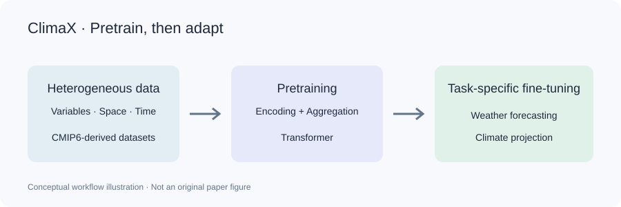

## 一句话总结

ClimaX 将变量集合不同的天气与气候网格数据组织为统一的 Transformer 输入，用随机预报时距预训练，再通过微调适配全球预报、区域预报、次季节预测、气候投影与降尺度。核心贡献是可复用的科学模型底座，而不是无需适配就能解决所有气象问题的预测器。

## 研究背景与动机

问题不只是提高某一项预报准确率，而是减少每换一个变量、区域或任务就重新训练模型的成本。传统数值模型以物理方程组织天气与气候过程；许多数据驱动模型却围绕固定变量、网格和预测时距设计，难以复用。

数据也不整齐：温度、风速、湿度等变量的集合不同，覆盖区域、分辨率和时间范围也不同。把所有变量当作固定图像通道，会锁死输入形式；只保留所有数据共有的变量，又会浪费数据。

作者的切入点是用气候模拟数据扩充预训练材料，并设计能处理异构变量的表示。这里的“基础模型”指共享预训练起点再适配多个任务，不是只看参数量。依据：论文第 1 节。

## 方法详解

整体流程：多变量网格 → 逐变量切分与编码 → 同一空间位置的变量聚合 → 加入位置与预报时距信息 → Transformer → 预测头还原目标网格。

1. 逐变量编码。输入形状为 V × H × W，其中 V 是变量数，H、W 是网格高和宽。每个变量分别切成 patch，加入变量身份信息。温度和风速有各自的表示入口，模型不必永久固定一套图像通道，可以处理不同变量子集。

2. 变量聚合。独立编码产生 V × h × w 个 token，其中 h、w 是切块后的空间网格尺寸。模型在每个空间位置，用可学习查询对 V 个变量表示做交叉注意力，聚合成一个表示；主干序列缩短为 h × w。这个接口同时融合变量信息并控制注意力开销。

3. 预训练。论文选用五个 CMIP6 数据源，统一重网格后训练。每个样本随机选择 6 至 168 小时的预报时距，把时距嵌入提供给模型，预测未来网格。损失为纬度加权均方误差，使全球误差的统计更符合不同纬度网格面积。任务是时间预测，而非直接照搬语言模型的掩码补全。

4. 下游适配。已见变量可以微调整个模型；全新变量需要替换输入嵌入层和预测头，保留、冻结或微调共享组件；分辨率变化还需调整位置嵌入。“支持未见变量”因此不等于任意变量的零样本预测。依据：第 2 节、图 2–3、第 3 节。

*ClimaX 训练流程示意图：异构数据预训练，再针对天气预报与气候预测微调。此图为流程示意，并非论文原图。*

[图片来源](https://www.microsoft.com/en-us/research/articles/introducing-climax-the-first-foundation-model-for-weather-and-climate)

## 实验关键数据

评测问题是“同一个预训练起点能否适配不同任务”。天气实验使用 ERA5 再分析数据，气候投影使用 ClimateBench。天气指标主要为纬度加权均方根误差 RMSE（越低越好）和异常相关系数 ACC（越高越好）；不同任务的指标不能合并成一个总榜。

全球与区域预报｜第 3.1 节、图 4–5。全球实验分别检查 Z500（500 hPa 位势）、T850（850 hPa 温度）、T2m（2 米气温）、U10（10 米纬向风速）及不同预报时距，并按目标与时距微调单独模型。原文比较 IFS、ResNet 和 UNet；训练分辨率不同的其他方法不能据此无条件横向排名。区域实验检查北美适配，以及低分辨率预训练向较高分辨率的迁移。

次季节预测｜表 1，5.625° ERA5-S2S。目标是第 3–4 周或第 5–6 周的两周平均量，不是逐小时预测六周后的天气。第 5–6 周 T2m 的 RMSE：UNet 1.79，未预训练的 Cli-ViT 1.90，ClimaX 1.70；T850 对应为 1.95、1.96、1.92。结果支持预训练收益，也说明收益随变量变化。

气候投影｜表 2，ClimateBench。输入为人为强迫因子，输出为年度气候统计量；任务和输入语义均不同于预训练。Total = NRMSEs + 5 × NRMSEg，越低越好。地表温度：原始 ClimateBench-NN 基线 0.327，作者复现基线 0.524，ClimaX 0.300，ClimaXfrozen 0.297。原始与复现基线必须区分，不能挑较差基线来夸大提升。

反例：降水 Total 的原始基线为 3.175，ClimaX 为 3.390；90 分位降水对应为 4.339 与 4.397。ClimaX 并非所有指标都更好。冻结共享主干在部分小样本任务上更有效，作者讨论了完整微调的过拟合问题。

降尺度与规模分析｜第 3.3–3.4 节。论文还检查粗到细网格适配，以及数据量、模型容量和分辨率的影响。这些实验支持通用预训练路线，但不等于验证了所有极端天气、任意新区域或业务部署。

## 亮点与洞察

变量编码保留身份，变量聚合形成可共享空间表示，两者解决不同问题。理解这些接口，比只记住“使用 Transformer”更有价值。

迁移被拆成新区域、新分辨率、新时间尺度和新变量等可检验轴，而不是把所有变化都笼统叫“泛化”。温度收益、降水不足和冻结主干的效果共同说明，预训练知识的可复用性取决于变量特性与下游数据量。

对 AI4S 的启发（解读推断）：其他科学领域也可先区分必须保留身份的输入与可共享的表示，再设计预训练和适配接口。这是研究思路，不是本文已经验证了分子、材料或生物任务。

## 局限与展望

原文确认的边界：任务需要适配训练；部分降水指标不占优；降尺度实验没有包含因缺少辅助数据而无法运行的 YNet 对照，因此不能声称超越所有降尺度方法。

物理与可靠性（解读判断）：从模拟数据学习，不等于模型显式保证质量或能量守恒。部署仍需检查极端事件、分布变化、长时误差与不确定性。这些是进一步验证要求，不能写成本文已经完成的结论。

未来研究可以围绕可检验物理约束、更丰富的变量与分辨率、统一的准确率—成本—可靠性评估协议展开。应记录收益与失败条件，而不是只给主观星级。

## 相关工作与启发

与 ViT：ClimaX 复用空间 token 和 Transformer，但气象变量不像 RGB 通道固定，因此增加逐变量编码和变量聚合。科学输入的组织与共享接口是关键。

与 FourCastNet、Pangu-Weather 等任务专用系统：它们强调预报能力；ClimaX 还关注不同天气与气候任务的适配。原文说明训练分辨率不同，这里比较研究目标，不据此排列准确率。

与数据和基准：CMIP6 提供预训练模拟；ERA5 用于天气适配与评估；ClimateBench 检查人为强迫到年度气候统计量的映射。三者角色不同。依据：第 1–3 节、附录 F.4。

## 复现与阅读建议

先读图 2–3，跟踪输入形状、变量编码、聚合、主干和预测头；再读第 2.4 节核对时距与微调协议；最后选一个下游任务，逐项检查数据划分、变量与指标。

从官方 microsoft/ClimaX 仓库开始。记录提交版本、数据版本、变量列表、网格、归一化统计、时距、训练/验证/测试年份以及是否冻结主干。先跑通单任务，再增加迁移实验，更容易定位问题。

本解读的数值来自正式论文表 1–2，比较范围来自图 4–5。页面配图是示意图，原始结构图与完整实验表格请查看 PDF。已核对引用章节和表格，未执行训练或独立复现实验。

<!-- language: en -->

## One-sentence summary

ClimaX unifies heterogeneous weather and climate grids, pretrains with randomized forecast horizons, and adapts to forecasting, climate projection and downscaling through fine-tuning. It is a reusable backbone, not a universal zero-shot forecaster.

## Background and motivation

The goal is to avoid retraining each variable, region or task in isolation. Many learned models assume fixed channels, grids and horizons, whereas scientific datasets vary in all three. Fixed channels restrict reuse; intersecting variable sets wastes data. ClimaX uses simulated climate data and an input representation designed for heterogeneity. A foundation model here means a shared pretrained starting point followed by adaptation, not merely a large model. Source: Section 1.

## Method explained

Pipeline: grids → independent variable patches → aggregation at each spatial position → position and lead-time embeddings → Transformer → output grids.

Variable tokenization preserves variable identity and permits different input subsets. Aggregation uses a learned query over variables at each location, reducing V × h × w tokens to h × w before the backbone.

Pretraining uses five regridded CMIP6 sources, randomized horizons of 6–168 hours and latitude-weighted squared error. It predicts future fields rather than masked language tokens.

Fine-tuning can update the full model for familiar variables. New variables require replacement embeddings and heads, with shared components retained or adapted. New resolutions also require positional adaptation. This is not arbitrary zero-shot prediction. Sources: Section 2, Figures 2–3 and Section 3.

*Conceptual ClimaX workflow: pretrain on heterogeneous data, then fine-tune for weather and climate tasks. This is an illustration, not an original paper figure.*

[Figure source](https://www.microsoft.com/en-us/research/articles/introducing-climax-the-first-foundation-model-for-weather-and-climate)

## Key experimental evidence

ERA5 evaluates weather tasks; ClimateBench evaluates climate projections. Weather RMSE is lower-is-better and ACC higher-is-better. Metrics across tasks are not a single league table.

Section 3.1 and Figures 4–5 examine global and regional forecasts with task-specific fine-tuning. Training resolutions constrain comparisons.

Table 1: 5.625° ERA5-S2S predicts two-week averages. For weeks 5–6 T2m, RMSE is 1.79 for UNet, 1.90 for scratch-trained Cli-ViT and 1.70 for ClimaX. T850 values are 1.95, 1.96 and 1.92. Gains vary by variable.

Table 2: Total = spatial NRMSE + 5 × global NRMSE. Surface-temperature Total is 0.327 for the published baseline, 0.524 for its reproduced version, 0.300 for ClimaX and 0.297 for ClimaXfrozen. Keep baseline versions distinct.

Precipitation Total is 3.175 for the published baseline versus 3.390 for ClimaX; 90th-percentile precipitation values are 4.339 versus 4.397. The model is not best on every metric. Freezing shared layers can help small-data adaptation. Sections 3.3–3.4 also study downscaling and scaling; these are not universal deployment guarantees.

## Highlights and insights

Variable encoding preserves identity while aggregation constructs a shared spatial representation. These interfaces explain more than the label Transformer. Transfer is tested across region, resolution, horizon and variable, rather than treated as one vague ability. Temperature gains, precipitation weaknesses and freezing results show that reuse depends on variable characteristics and data size.

AI4S interpretation: distinguish identity-specific inputs from reusable representations before designing pretraining interfaces. This is an analogy, not verified transfer to molecular, materials or biological tasks.

## Limitations and outlook

Established boundaries: tasks require adaptation; some precipitation metrics are weaker; YNet is absent from downscaling comparisons because auxiliary data was unavailable. Universal superiority is unsupported.

Interpretation: training on simulations is not an explicit conservation guarantee. Extremes, shifts, long-horizon errors and uncertainty still require validation. Useful directions include physical constraints, broader data and common accuracy–cost–reliability protocols.

## Related work and connections

ViT supplies spatial tokens and a backbone; ClimaX adapts them to variable scientific inputs. Task-specific systems such as FourCastNet and Pangu-Weather emphasize forecasting, whereas ClimaX also examines cross-task adaptation. Different training resolutions prevent unconditional rankings. CMIP6 provides pretraining simulations, ERA5 supports weather adaptation and evaluation, and ClimateBench tests forcing-to-climate-statistics mapping. Sources: Sections 1–3 and Appendix F.4.

## Reproduction and reading guide

Start with Figures 2–3, then Section 2.4, then one downstream protocol. Use the official repository and record commit, data version, variables, grid, normalization, horizons, splits and freezing choices. Establish one task before transfer experiments. Numerical evidence here comes from Tables 1–2 and comparison scope from Figures 4–5. The page image is conceptual; consult the PDF for original figures. Cited sections and tables were checked, but training and independent reproduction were not performed.
